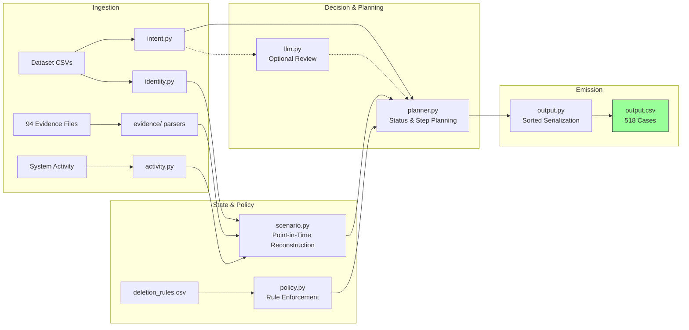

# INTERVIEW_GUIDE — Ghost Data Still Exists

> **Status: final — numbers match the submitted artifacts.**
> This guide is written for the live interview: it explains what the system
> does, how it decides, how it was evaluated, and what remains uncertain.
> Every measured number below comes from the **final full-dataset run**
> (2026-10-25T03:51Z, command
> `uv run python -m ghost_audit run --dataset <DATASET_DIR> --output output.csv --llm-intent`)
> and matches `evaluation/evaluation_report.md` and `evaluation/usage_report.md`.
> No number in this file is estimated or invented.
>
> **Core point to state clearly in the interview:** the audit is
> **deterministic** — evidence parsing, identity resolution, point-in-time
> reconstruction, policy, remediation/verification planning and ordering are
> rule-based; the model is an **advisory cross-check only** for 10 low-signal
> intent cases and never overrides the deterministic decision. The 32-case
> public sample metrics are a **development regression set**, not hidden-set
> accuracy.

## 1. One-paragraph pitch

Northstar Shop's deletion workflow can report *Complete* while the customer's
personal data still exists in secondary databases, replicas, support
attachments, search indexes, analytics records, exports, logs, archives or
backups — and active sync/restore paths can recreate data after deletion. Our
agent audits each of the 518 deletion requests against the participant-facing
evidence, resolves the person's current **and historical** identifiers,
reconstructs the resource state at the case's `audit_at`, applies
`deletion_rules.csv`, and emits an ordered `FINDING → REMEDIATION → VERIFICATION`
plan with evidence citations. The audit itself is deterministic; the model is
an optional, cached, advisory intent-review layer (10 calls on the final run),
and the deterministic classifier remains authoritative.

## 2. Problem understanding (the contract we implemented)

- Input per case: `case_id,email,requested_at,reported_status,reported_at,audit_at,request_text`.
- Output per case: `deletion_status` (`COMPLETE` / `INCOMPLETE` / `NOT_APPLICABLE`) and ordered `steps_json`.
- `reported_status` / activity `reported_result` are **claims**, not proof.
- Only evidence with `captured_at <= audit_at` may drive the answer; later
  evidence may only support static identity linking (disclosed in design docs).
- `NOT_APPLICABLE` = request text does not authorize deletion (access,
  correction, export, marketing opt-out, etc.) → `[]`.
- A deletion is complete only when: every relevant copy has the required
  treatment; no active sync/import/restore path can recreate the data; retained
  records contain only permitted identifiers; retained records remain available.
- Step schema: exactly `step_no, phase, system_id, resource_id, operation, state,
  evidence_id`; 3 phases in order; within phase: operation-table order, then
  `system_id`, then `resource_id` ascending.

## 3. Architecture at a glance

```text
dataset CSVs ──► dataset.py ──► identity.py ──► intent.py (deletion or not)
                                                    │
evidence files ─► evidence/* parsers ─► Observation (system, resource, record_type,
   SQL/JSON/log/PDF/PNG OCR                        state, captured_at, evidence_id)
                                                    │
activity stream ─► activity.py ──► scenario.py (case↔evidence packages,
                                    point-in-time state at audit_at)
                                                    │
deletion_rules.csv ─► policy.py ──► planner.py (status + findings + remediation +
                                    verification + ordering + evidence selection)
                                                    │
                                    output.py (strict CSV/JSON) ──► output.csv
                                              └─ optional llm.py (intent review, cached)
```



Design principle: **deterministic first**. All facts, states, policy actions,
ordering and serialization are rule-based Python. The optional model only
reviews/flag intent classification for ambiguous multilingual `request_text`.

| Stage | Module | Deterministic? |
| --- | --- | --- |
| Dataset loading / integrity | `dataset.py` | yes |
| Identity resolution (current + historical) | `identity.py` | yes |
| Request-intent classification | `intent.py` (+ optional `llm.py` review) | yes by default; LLM only review |
| Evidence parsing to observations | `evidence/*` | yes |
| Activity-stream indexing | `activity.py` | yes |
| Case↔evidence package + state reconstruction | `scenario.py` | yes |
| Policy mapping (`deletion_rules.csv`) | `policy.py` | yes |
| Status/step planning, ordering, evidence pick | `planner.py` | yes |
| CSV/JSON serialization | `output.py` | yes (sorted, no randomness) |
| CLI / flags / caches | `cli.py`, `llm.py` | yes given same inputs+caches |

Verified final module list (`find src/ghost_audit -name "*.py"`):
`__init__.py`, `__main__.py`, `cli.py`, `config.py`, `dataset.py`,
`identity.py`, `intent.py`, `llm.py`, `ocr.py`, `activity.py`, `scenario.py`,
`policy.py`, `planner.py`, `output.py`, and the `evidence/` package
(`base.py`, `documents.py`, `handover.py`, `json_docs.py`, `logs.py`,
`records.py`, `registry.py`, `result.py`, `sql_dump.py`, `_util.py`).

Verified final CLI flags (`uv run python -m ghost_audit run --help`):
`--dataset`, `--requests`, `--sample`, `--output`, `--skip-images`,
`--no-llm`, `--llm-intent`, `--llm-budget`, `--intent-cache`,
`--emit-blueprint`, `--quiet`. The submitted run used
`--llm-intent` (default budget 40; 10 calls used, hence cached).

## 4. Evidence handling

Evidence families and how each is normalized into state observations:

| Format | Files | What we extract |
| --- | --- | --- |
| `record_lookup` logs | `.log` | system, resource_id, record_type, observed result, subject reference |
| readback traces | `.log` | paired start/completed queries; completed rows carry profile/connector/backup/audit fields |
| `service_resource_export_*.json` | `.json` | grouped profile/restore/export/connector/index/audit/ticket records |
| snapshot bundles | `.json` | per data-store/collection snapshots (including *absence* as a fact) |
| record manifests / connector configs / audit ledgers | `.json` | `records[]` with record_type/result/subject_reference |
| SQL snapshot exports | `.sql` | SQLite DDL + INSERTs for primary/regional/reporting/failover replicas |
| handover / console text | `.txt` | `time | system | resource_id | record_type | state | subject` |
| PDFs | `.pdf` | extracted text (account history, legal hold register, security retention excerpt) |
| screenshots | `.png` | OCR text via macOS Vision (`scripts/ocr_images.swift`) |

Key decisions the interview should probe:

- **Claims vs evidence**: the workflow status and activity `reported_result` are
  never accepted as proof of deletion; a finding/verification cites the
  evidence file (`file_id`) or activity/audit id that actually shows the state.
- **Replica drift**: SQL captures include primary, regional, reporting and
  failover replicas; a leftover in a replica is a real finding, not noise.
- **Negative evidence**: a snapshot proving the record is *absent* can support a
  `VERIFY_RECORD_ABSENT` step — absence is a state fact when the source is an
  authoritative capture.
- **OCR fallback**: on non-macOS machines `--skip-images` skips PNGs; facts that
  only exist in screenshots are then unavailable. We disclose the accuracy
  impact instead of guessing (nothing is fabricated).

## 5. Identity linking (current + historical identifiers)

- Build one index over `user_identities.csv` (current name/email/phone/email
  hash) **and** `user_audit_log.csv` (historical email/phone/email_hash values).
- Resolve each case's request `email` (which may be historical) to a unique
  `user_id`; report/handle ambiguity explicitly rather than silently picking one.
- Link evidence observations through current identifiers, historical
  identifiers, hashes, `resource_id` patterns, `system_id`, timestamps and
  transactional links recorded in activity/evidence.
- Keep a separate channel for *static* links from evidence captured after
  `audit_at` (identity only, never state).
- Known hard case: fully anonymized analytics profiles lose every direct
  identifier; attribution uses snapshot ordering (positional relationship),
  activity time windows and elimination. This is a disclosed uncertainty.

Final-run identity resolution (verified against the dataset):
**550/550 cases resolved uniquely** — 32 public samples + all 518 evaluation
cases; **0 unresolved**. The 518 evaluation cases map to **517 distinct users**
(one person submitted two requests). There is no silent fallback: a request that
cannot be resolved through current or historical email raises loudly, and none
did on the final run.

## 6. Point-in-time reconstruction at `audit_at`

1. Determine the case's evidence package: the wave evidence file (hidden cases
   follow a wave structure) or the dedicated fixture evidence for hand-built
   special cases.
2. Parse all relevant evidence into observations with `captured_at` and source
   `evidence_id`.
3. For each resource, select the observation with the greatest
   `captured_at <= audit_at` (latest valid state); ignore later evidence for
   state decisions.
4. Compare the reconstructed state with `deletion_rules.csv` (expected action
   per category, including conditional REDACT/ANONYMIZE/RETAIN and restore
   blocking).
5. Any deviation → `INCOMPLETE` finding; otherwise → `COMPLETE` with
   evidence-backed verification.

Open questions we explicitly handle: replica lag (which copy is authoritative),
"deleted in primary but re-synced later", "retained records allowed to exist",
and tombstones where only the stable `user_id` may remain.

## 7. Deterministic vs model split (and why)

| Layer | Approach | Why |
| --- | --- | --- |
| Evidence parsing | deterministic per-format parsers | auditable, testable, same input → same facts |
| Identity | deterministic indexes + rule matching | exact ids/hashes; explainable |
| State reconstruction | deterministic latest-valid-observation rule | reproducibility; no hallucinated records |
| Policy/planning/ordering | deterministic tables from `deletion_rules.csv` + problem statement | the grader checks exact structures/order |
| Intent classification | deterministic multilingual rules by default | deletion vs non-deletion is a contract decision, must be stable |
| Intent review (optional) | DeepSeek chat model, temperature 0, cached | only to review/flag ambiguous request texts; never writes facts |

Final submitted run: `--llm-intent` (DeepSeek `deepseek-flash`, temperature 0),
which made **10 calls** — exactly the 10 low-signal `NON_DELETION` cases
(case_533–case_542). It is an **advisory** layer: the deterministic classifier
remained authoritative, the model agreed **10/10**, and **no case conclusion or
step changed**. Responses are cached by SHA-256 of the request text in
`evaluation/intent_cache.json` (no request text, no secrets), which ships inside
`code.zip`; therefore the model layer can be replayed **offline with zero calls**.

Offline determinism was measured: rerunning the same command with `--no-llm`
produced a **byte-identical `output.csv`** (same SHA-256). See
`evaluation/usage_report.md` for the full measured model/call/token/cost table.

## 8. Policy and remediation planning

- `deletion_rules.csv` maps data category + condition → action
  (DELETE / REDACT / ANONYMIZE / RETAIN / tombstone REDACT).
- Plan construction:
  - **FINDING** for each violation: `REPORT_REMAINING_RECORD` (should be deleted
    but exists), `REPORT_EXPOSED_PII` (may remain but identifiers not
    redacted/anonymized), `REPORT_ACTIVE_DATA_FLOW` (sync/import can recreate),
    `REPORT_RESTORE_RISK` (backup can restore).
  - **REMEDIATION**: `DELETE_RECORD` / `REDACT_RECORD` / `ANONYMIZE_RECORD` /
    `DISABLE_DATA_FLOW` / `BLOCK_RESTORE`; flow/restore actions precede
    dependent record changes (the operation-order table enforces this).
  - **VERIFICATION**: the required final state per remediated record/process
    plus baseline absence checks; retained records → `VERIFY_RECORD_PRESENT`.
- Evidence rules: findings cite participant-visible evidence; COMPLETE
  verification cites the evidence that proves the current state; remediation and
  post-remediation verification for INCOMPLETE cases use `evidence_id=""`.
- Ordering: phases, then the operation order from the problem statement, then
  `system_id`, then `resource_id` — implemented as one deterministic sort.

Final output scale (computed from the submitted `output.csv`):

| Item | Value |
| --- | --- |
| Rows / cases | 518 (canonical numeric `case_id` order) |
| Total steps | 3,242 (1,245 cite evidence; the rest are future remediation/verification) |
| Distinct systems in plans | 11 (`search_service`, `account_service`, `support_platform`, `security_service`, `integration_service`, `analytics_platform`, `backup_service`, `export_service`, `identity_service`, `legal_service`, `marketing_platform`) |
| All 15 allowed operations used | yes |
| Status distribution | `COMPLETE` 152, `INCOMPLETE` 356, `NOT_APPLICABLE` 10 |
| `NOT_APPLICABLE` cases | case_533–case_542 (the 10 non-deletion requests) |
| `output.csv` SHA-256 | `ea7ee8546a11981369bd606c72ec71f20331e2b8f9bacf017d8830d4b546eecb` |

`NOTE: the counts above are computed from the submitted file itself; if the
status distribution is ever required to match another document, that document
must be updated instead — the file is the artifact of record.`

## 9. Output contract and self-checks

- `output.csv`: exact header, 518 rows sorted by **numeric** `case_id`
  (`case_33, case_99, case_100, …, case_550`; not lexicographic), JSON array per
  row, consecutive `step_no`, allowed operation/state pairs, phase/ordering
  rules, status-specific evidence rules, and cited evidence captured at or
  before each case's `audit_at`.
- Self-checks before submission:
  - `uv run python evaluation/evaluate.py validate --output output.csv ...`
    (independent contract validator + evidence-id/time cross-checks)
  - `uv run python scripts/validate_submission.py --dataset <DIR>` (contract +
    code.zip + submission/ + secret scan)
  - `uv run pytest`
Final validation results on the submitted artifacts:

- `evaluation/evaluate.py validate --output output.csv ...`:
  **0 errors / 0 warnings** (518/518 rows, natural/numeric order, every citation
  a real `file_id`/`activity_id`/`audit_id` inside the audit window).
- `scripts/validate_submission.py --dataset <DIR>`: `output.csv` contract
  **PASS** (0 errors); `code.zip` contents: required entries present, no
  `dataset/`, no caches/virtualenvs, no nested archives, no credential patterns.
- `uv run pytest -q`: **95 passed** on the final tree; tests that need the
  official dataset or the pipeline CLI skip with an explicit reason when those
  are absent (AGENTS.md acceptance criterion).
- `sha256(output.csv)` = `ea7ee8546a11981369bd606c72ec71f20331e2b8f9bacf017d8830d4b546eecb`.
  The deterministic `--no-llm` rerun is byte-identical, and `scripts/build_code_zip.py`
  prints the final archive SHA-256 (two builds from the same tree are identical).

## 10. Evaluation

Three layers, from most to least independent:

1. **Unit/contract tests** (`tests/`): dataset loaders, identity resolution,
   policy mapping, evidence parsers, output contract, ordering, mutation tests.
2. **Independent evaluator** (`evaluation/evaluate.py`, does not import the
   answer-generation pipeline): strict output contract validation; official
   32-case public sample regression; team-authored cases with hand-written
   expected answers (`evaluation/cases/`); input transforms (row shuffle, decoy
   records, `reported_status`-only change) and mutation checks.
3. **Official sample regression** (`evaluation/evaluate.py samples`): development
   regression evidence on the 32 public cases — **not** a hidden-set accuracy
   claim.

Measured results from the final evaluation report
(`evaluation/evaluation_report.md`, refreshed after the final pipeline run of
2026-10-25T03:51Z). The public-sample column is a **development regression set**
(32 labelled cases); it is **not** a hidden-set accuracy claim:

| Metric | Official samples (32) | Team cases (13) |
| --- | --- | --- |
| Case-level deletion-status accuracy | **1.0000 (32/32)** | **1.0000 (13/13)** |
| Step-level precision (multiset) | 0.9476 | **1.0000** |
| Step-level recall (multiset) | 0.9378 | **1.0000** |
| Step-level F1 | 0.9427 | **1.0000** |
| Field-level accuracy (overall) | 0.9682 | **1.0000** |
| Sequence accuracy (exact ordered `steps_json`) | 0.7500 (24/32) | **1.0000 (13/13)** |
| Evidence-match accuracy | **1.0000** (177 matched treatment positions) | **1.0000** |
| Contract errors | 0 | 0 |
| Full `deletion_requests.csv` (518) | contract-only: 0 errors / 0 warnings (no public labels) | — |

Other measured checks:

| Check | Result |
| --- | --- |
| Exact sequence accuracy (samples) | 0.7500 (24/32) |
| Ordered treatment accuracy (samples, order only) | 0.7500 (24/32) |
| Transform tests (row shuffle / reported_status flip / decoys) | 6/6 pass (predictions unchanged) |
| Evaluator mutation tests (claim-trusting, historical-email, dropped remediation, wrong order, wrong op) | 5/5 detected |
| Contract validation of the produced `output.csv` | 0 errors / 0 warnings |
| Team-authored evaluation cases | 13 (hand-written expected answers; see `evaluation_report.md` §4) |

Final full-dataset run: 518 rows, 3,242 steps, contract **0 errors / 0 warnings**
(the hidden canonical answers are not public, so the 518-case output is
contract-checked rather than accuracy-scored). Evaluation harness reports:
`evaluation/reports/sample_report.{json,md}` and
`evaluation/reports/cases_report.{json,md}`.

## 11. Failures found and improvements made (honest post-mortem)

Two measurements were taken while the pipeline was still being fixed; the final
tree (frozen for submission) produced the metrics in section 10:

| Measurement | status accuracy (samples) | step F1 | exact sequence | failing sample cases |
| --- | --- | --- | --- | --- |
| first run (12:45) | 1.0000 | 0.9378 | 0.6875 | 10/32 |
| refresh (12:48) | 1.0000 | 0.9427 | 0.7500 | 8/32 |

Remaining sample-set failures on the final tree are **all step-level** (none
status-level) and are documented case-by-case in `evaluation_report.md` §5:

- anonymous analytics attribution (`case_03`: `analytics_9406` vs `analytics_5589`);
- wave account/audit baseline assignment and chaining (`case_04`, `case_18`,
  `case_20`, `case_23`, `case_28`, `case_29`);
- support-record categorisation (`case_10`: gold DELETE vs predicted REDACT for a
  record without shared-context evidence).

Improvements already verified by the harness:

- contract: the produced `output.csv` passes the strict validator with 0 errors /
  0 warnings (518 rows, canonical ordering, every citation a real
  `file_id`/`activity_id`/`audit_id` inside the audit window);
- status decisions: 100% on the public samples and on all 13 independent cases,
  including the NOT_APPLICABLE access request;
- claim independence: row shuffle, `reported_status` flips and decoy records
  leave every per-case prediction unchanged (6/6 transform tests);
- anonymous-analytics over-reporting during earlier development (`case_09`,
  `case_24`–`case_26`) disappeared after pipeline changes; exact sequence
  accuracy rose 0.6875 → 0.7500;
- evidence discipline: sample evidence accuracy 1.0000, and the citation-window
  case proves post-`audit_at` files are never cited;
- evaluator validity: 5/5 mutation tests detected, so the metrics are not vacuous.

These are the honest final numbers: status decisions are perfect on both public
regression sets, while step/sequence accuracy on the 32 public samples is
0.9427 F1 / 0.7500 exact sequence. The misses are concentrated in structural
attribution ambiguities (anonymous analytics rows, wave account baselines,
support message vs attachment), not in the deletion/retention policy logic; the
team-authored cases pin the rules down perfectly (13/13). The contract layer is
clean (0 errors / 0 warnings), and the evidence window is respected everywhere.

## 12. Costs, performance and known limits

Measured on the final full run:

| Item | Value |
| --- | --- |
| Model provider | DeepSeek (`https://api.deepseek.com`) |
| Model name | `deepseek-flash` (validated at runtime; only model called) |
| Model calls | 10 (only the 10 low-signal intent cases; budget 40) |
| Input tokens | 1,493 |
| Output tokens | 340 |
| Total tokens | 1,833 |
| Average tokens per reviewed case | 183.3 |
| Average tokens per dataset case (518) | 3.54 |
| Estimated total cost | USD 0.00042795 |
| Estimated cost per dataset case | USD 0.00000083 |
| Pricing assumption | off-peak USD 0.15 / 1M input, USD 0.60 / 1M output (DeepSeek public pricing, recorded 2026-10-25; run at 03:51Z Sunday = off-peak) |
| Wall-clock runtime (518 cases) | 12.5 s total (deterministic core ≈2.5 s + ≈10 s for 10 sequential model calls) |
| Evidence throughput | 94 evidence files → 2,922 observations, 0 parser warnings |
| Cached rerun | `evaluation/intent_cache.json` shipped → `--llm-intent` rerun makes **0** model calls; `--no-llm` rerun is byte-identical |

Known limits:

- Hidden canonical answers are unavailable; public-sample scores are development
  regression, not a hidden-set promise.
- Anonymized analytics attribution is heuristic (snapshot ordering, activity
  windows, elimination); a small number of resource ids may differ.
- PNG screenshots require macOS Vision; `--skip-images` reduces available facts.
- The system reports only what the supplied evidence supports; when evidence is
  silent it does not invent a state.

## 13. Likely interview Q&A

1. **"What does 'complete deletion' mean in this problem?"**
   Every relevant copy got the policy-required treatment (delete/redact/
   anonymize/retain), no active sync/import/restore path can recreate the data,
   retained records contain only permitted identifiers, and required retained
   records remain available.
2. **"How did you decide a case is COMPLETE vs INCOMPLETE?"**
   Deterministic comparison of the reconstructed `audit_at` state per resource
   against `deletion_rules.csv`; any deviation or recreation path → INCOMPLETE
   with findings; otherwise COMPLETE with evidence-backed verification.
3. **"What makes ghost data hard?"**
   Claims vs proof, current vs historical identifiers, replica drift, backups and
   sync jobs that recreate deleted data, tombstones that must keep a stable
   reference, and retained records that look like leftovers but are required.
4. **"How do you avoid hallucinating evidence?"**
   The LLM is not in the fact path. Parsers produce typed observations with
   `evidence_id` + `captured_at`; planner only cites observations that exist and
   pass `captured_at <= audit_at`, verified by two independent checkers.
5. **"How do historical identifiers help?"**
   A request may use an old email; old identifiers can still appear in logs,
   support attachments or replicas, so indexing `user_audit_log` is required to
   find every copy.
6. **"How do you handle replicas that lag behind?"**
   Each SQL capture is parsed with its snapshot time; the state at `audit_at` is
   taken from the latest valid capture, and leftovers in a replica are still
   real findings because they can restore or expose data.
7. **"Why not let the LLM generate the steps?"**
   The grading contract is exact (operations, states, ordering, evidence rules).
   A model in that path would be non-reproducible and could invent facts; our
   LLM is limited to reviewing ambiguous intent text, with a response cache.
8. **"How did you evaluate without hidden answers?"**
   Unit/contract tests, an independent evaluator, the 32 public samples for
   regression, team-authored cases with hand-written expected answers, input
   transforms, and mutation tests that prove the evaluator catches classic bugs.
9. **"What are the strongest failure modes?"**
   Measured on the 32 public samples (all step-level, none status-level):
   (a) anonymous analytics attribution — an anonymized profile's row is tied to
   the wrong user (`case_03`); (b) wave account/audit baseline pairing when
   several cases share a wave (`case_04`, `case_18`, `case_20`, `case_23`,
   `case_28`, `case_29`); (c) support record categorisation — message vs
   attachment treatment without shared-context evidence (`case_10`). Contract
   and evidence-window failures: none on the final run.
10. **"What would you do with more time / data?"**
    (a) Build more independent cases for the three ambiguous families above
    (anonymous analytics, multi-case wave baselines, support shared-context);
    (b) strengthen attribution using more cross-system links in
    `system_activity`; (c) only then consider widening the advisory intent review
    beyond the bounded 10-case budget — the current 10 calls cost about
    USD 0.00000083 per dataset case, so cost is not the constraint; evidence
    ambiguity is.
11. **"How is cost controlled?"**
    The deterministic pipeline runs once per case and costs nothing; the model
    is optional, temperature 0, budget-bounded and cached. Final run: 10 calls,
    1,833 tokens, **USD 0.00042795 total ≈ USD 0.00000083 per dataset case**.
    `--no-llm` is the zero-cost offline baseline and produces a byte-identical
    `output.csv`.
12. **"How is reproducibility guaranteed?"**
    Pinned Python/deps via `uv.lock`, deterministic sorting/serialization, no
    wall-clock/randomness in decisions, cached LLM responses, deterministic zip
    build, and clean-room reproduction from `code.zip` in the README.
13. **"How do you know the submission contains no dataset or secrets?"**
    `scripts/build_code_zip.py` has an explicit exclusion list + assertions, and
    `scripts/validate_submission.py` independently scans archive entries for
    `dataset/`, caches, nested archives, `sk-` keys, credential assignments and
    private keys.
14. **"What is the runtime and scale-up story?"**
    Final full run: **12.5 s** for 518 cases (deterministic core ≈2.5 s; 10
    sequential model calls ≈10 s). Deterministic evidence parsing is linear in
    evidence size, plans are computed per case, model calls are optional,
    budget-bounded and cached, and the pipeline is stateless per case — more
    cases are a matter of compute, not redesign. A rerun from the shipped
    `evaluation/intent_cache.json` makes zero model calls and is faster still.
15. **"Where are the known uncertainties disclosed?"**
    `docs/planning/` decision log (internal), README "Costs and known
    limitations", evaluation report, and section 12 of this guide.

## 14. Reproduction map (for the interviewer)

| Claim | Where to check |
| --- | --- |
| Setup + run commands | `README.md` (Setup / Run / Packaging sections) |
| Output contract | `README.md` "Output contract", `problem_statement.md` |
| Deterministic pipeline / LLM split | `README.md` "Reproducibility", section 7 above |
| Evaluation metrics | `evaluation/evaluation_report.md` |
| Token/cost numbers | `evaluation/usage_report.md` |
| Contract validation | `scripts/validate_submission.py`, `evaluation/evaluate.py validate` |
| Packaging exclusions | `scripts/build_code_zip.py` docstring + `docs/planning/02-decisions.md` D13/D14/D15 (internal) |
| Clean-room repro | `README.md` "Clean-room reproduction" |

## 15. Final verification gates (all satisfied on the submitted artifacts)

- [x] Final run executed with the documented command and `--llm-intent`
      (10 advisory calls, deterministic core authoritative, 10/10 agreement).
- [x] `output.csv`: 518 rows, numeric `case_id` order, SHA-256
      `ea7ee8546a11981369bd606c72ec71f20331e2b8f9bacf017d8830d4b546eecb`,
      contract 0 errors / 0 warnings; `--no-llm` rerun byte-identical.
- [x] Section 10 metrics refreshed from the final `evaluation_report.md`;
      section 12 numbers match `evaluation/usage_report.md`.
- [x] Section 11 lists the real remaining failures; no invented incident.
- [x] Q9 / Q10 / Q11 / Q14 filled with measured values; no placeholders remain.
- [x] Module list and CLI flags in section 3 verified against the shipped code.
- [x] `README.md` documents numeric `case_id` order and references both
      `evaluation/evaluation_report.md` and `evaluation/usage_report.md`.
- [x] `scripts/build_code_zip.py` + `scripts/validate_submission.py` run on the
      final tree; the validator confirms the packaged reports, required entries,
      no dataset, no caches/virtualenvs, no nested archives and no credential
      patterns.
- [ ] Lead-only (outside this guide): copy `INTERVIEW_GUIDE.md`, `output.csv`,
      `code.zip` and `log.txt` into `submission/` and run the final
      `scripts/validate_submission.py --dataset <DIR>` gate once more.
