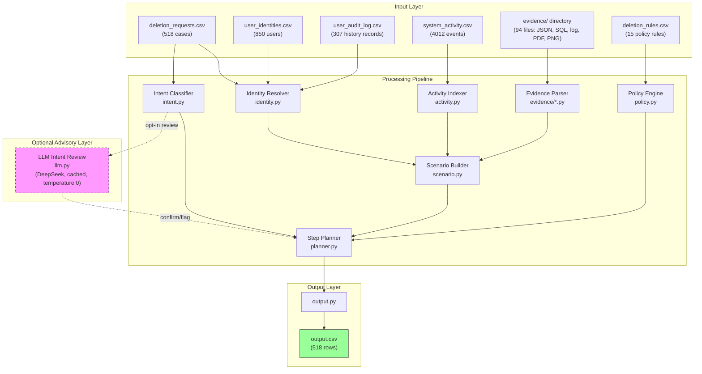
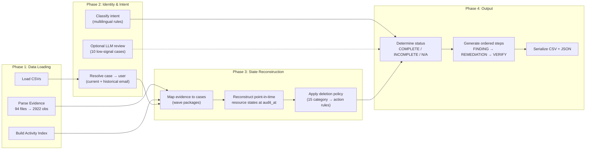
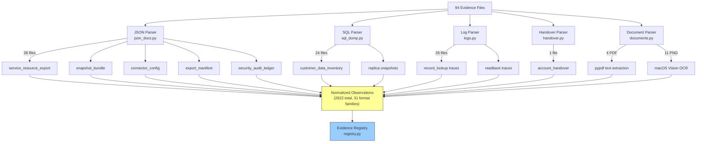
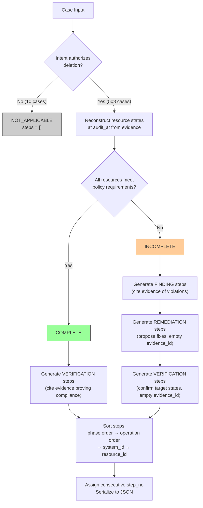
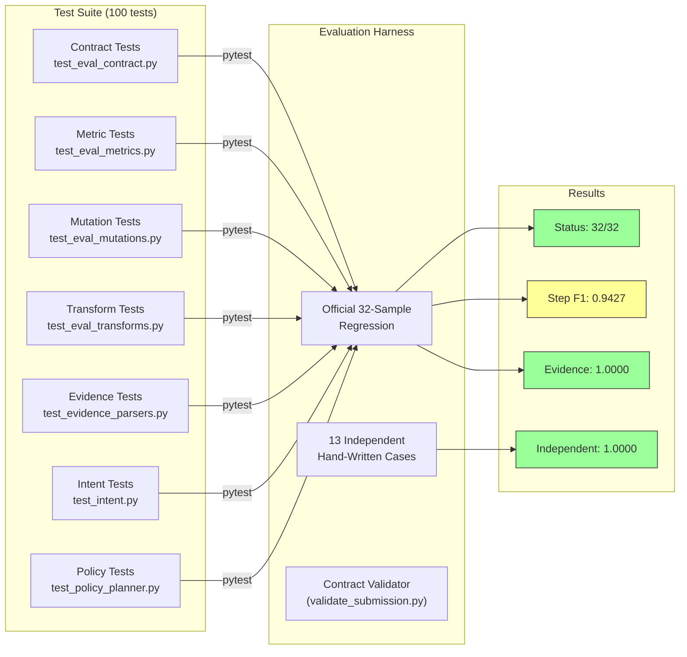

# Ghost Data Still Exists — Deletion Audit Agent

A participant solution for the **HackerRank Orchestrate October 2026** challenge
[*Ghost Data Still Exists*](https://www.hackerrank.com/contests/hackerrank-orchestrate-october26/challenges/ghost-data-still-exists).

**GitHub Repository:** [https://github.com/Rajkaran-122/Submission_october](https://github.com/Rajkaran-122/Submission_october)

A deletion workflow can report **Complete** while personal data survives in
secondary databases, replicas, support attachments, search indexes, analytics
records, exports, logs, archives and backups — and active sync/restore paths can
recreate data that was already deleted. This project audits every request in
`dataset/deletion_requests.csv` and produces an evidence-backed answer:

* `COMPLETE` — the required treatment reached every relevant copy, retained
  records are still available and no active sync/import/restore path can
  recreate prohibited data (output: evidence-backed verification steps only);
* `INCOMPLETE` — remaining records, exposed identifiers and recreation risks
  exist (output: findings, the complete ordered remediation plan and the checks
  that must pass afterwards);
* `NOT_APPLICABLE` — the request text does not authorize deletion (output: `[]`).

The pipeline is **deterministic first**: evidence parsing, identity resolution,
point-in-time state reconstruction, policy application, planner ordering and JSON
serialization are all rule-based. A model is used only as an optional, cached
**intent review/flag layer** (see [Reproducibility](#reproducibility)).

## Submission artifacts

| Artifact | Path | Notes |
| --- | --- | --- |
| Predictions | `output.csv` (repo root) | exactly 518 data rows, sorted by numeric `case_id` order |
| Runnable snapshot | `submission/code.zip` | built by `scripts/build_code_zip.py`; **no dataset** |
| Chat transcript | `submission/log.txt` | root `log.txt` (PART I) + generated conversation appendices (PART II) |
| AI interview guide | `submission/INTERVIEW_GUIDE.md` | architecture, evaluation, Q&A |

The official dataset is **not** included in `code.zip` and is never
redistributed by this repository; it is supplied separately by HackerRank.

## Requirements

* **Python 3.13** — pinned in [`.python-version`](.python-version).
* **[uv](https://docs.astral.sh/uv/)** for dependency management and running.
* **macOS + Swift toolchain** only for PNG screenshot OCR (`swift` must be on
  `PATH`; the helper is [`scripts/ocr_images.swift`](scripts/ocr_images.swift)
  and uses the system Vision framework). Everything else is cross-platform.
* No network access is required for the default (offline) run. `--llm-intent`
  is optional and needs a DeepSeek API key in the environment.

## Setup

From the directory that contains `pyproject.toml` (after extracting
`code.zip` or inside a clone of the repository):

```bash
export UV_CACHE_DIR="$PWD/.uv-cache"   # keep the uv cache inside the project
uv sync                                # creates .venv and installs exact deps
```

`UV_CACHE_DIR` is set explicitly because the build environment used for this
submission does not allow writes to `~/.cache/uv`; the project-local cache is
gitignored, excluded from `code.zip`, and harmless on unrestricted machines.

Verify the environment and the test suite:

```bash
uv run pytest                 # dataset-dependent tests skip when the dataset is absent
```

## Dataset

The official dataset is **not bundled**. Pass the directory that contains the
participant-facing files given by the challenge with `--dataset` (the CLI's
compiled-in default points at the local reference checkout
`docs/refs/hackerrank-orchestrate-october26-main/dataset`, which is a working-copy
convenience only and is not shipped, so a clean environment must pass the flag):

```text
<DATASET_DIR>/
├── deletion_requests.csv       # 518 requests to audit (the only rows scored)
├── sample_deletion_requests.csv / sample_output.csv   # public 32-case regression set
├── user_identities.csv         # current identities
├── user_audit_log.csv          # historical identifier changes
├── system_activity.csv         # global deletion/sync/restore/export activity stream
├── deletion_rules.csv          # category -> required action policy
├── evidence_files.csv          # evidence manifest (file_id -> path, origin, captured_at)
├── evidence/                   # JSON, SQL, logs, TXT, PDF and PNG evidence
└── output.csv                  # blank template (not used by the pipeline)
```

Only participant-facing files are used. Organizer-only truth is never read, and
the solution does not hardcode case families, golden labels or expected answers.
Predicted state is reconstructed from evidence at or before each case's
`audit_at`; `reported_status` / `reported_result` are treated as claims, never
as proof.

The team's working copy keeps a read-only checkout of the reference repository
(including `dataset/`) under `docs/refs/`, which is gitignored and never
packaged. In a clean environment point `--dataset` at the path HackerRank
provides.

## Run

Final full run that produces the submitted `output.csv` (documented in
`evaluation/usage_report.md`):

```bash
export UV_CACHE_DIR="$PWD/.uv-cache"
uv sync

uv run python -m ghost_audit run \
    --dataset "$DATASET_DIR" \
    --output output.csv \
    --llm-intent
```

Deterministic, fully offline run — no API key, no network:

```bash
uv run python -m ghost_audit run \
    --dataset "$DATASET_DIR" \
    --output output.csv \
    --no-llm
```

`--no-llm` (deterministic intent classification only) is the effective default:
a model is only contacted when `--llm-intent` is passed explicitly, so a
clean-room run without credentials or network still produces a complete 518-row
file. `--llm-intent` is an opt-in **review layer only**: the deterministic
classifier and the evidence/policy/planning code still decide every
`deletion_status` and every step; the review may only flag/confirm intent for
ambiguous request text and can never rewrite findings, evidence citations or
order. It is bounded by `--llm-budget` (default 40) and aimed at low-signal
decisions, so a full run makes few calls. Responses are cached (default
`evaluation/intent_cache.json`; the cache stores request hashes + labels, never
request text or secrets), so a rerun with the same cache is reproducible and
works offline. The exact model name, call count, tokens and cost of the final
run are recorded in `evaluation/usage_report.md`.

Public sample regression (32 cases, `--sample` selects
`dataset/sample_deletion_requests.csv`):

```bash
uv run python -m ghost_audit run \
    --dataset "$DATASET_DIR" \
    --sample \
    --output /tmp/sample_output.csv
```

The authoritative flag list is:

```bash
uv run python -m ghost_audit run --help
```

| Flag | Meaning |
| --- | --- |
| `--dataset DIR` | participant-facing dataset directory (defaults to the local reference checkout only; always pass it in a clean environment) |
| `--output FILE` | prediction CSV to write (default `output.csv`) |
| `--requests CSV` | override the request file (default `<dataset>/deletion_requests.csv`) |
| `--sample` | shortcut for `--requests <dataset>/sample_deletion_requests.csv` |
| `--skip-images` | skip PNG OCR (see below) |
| `--no-llm` | deterministic intent only; fully offline (default without a key) |
| `--llm-intent` | opt-in model review of low-signal intent decisions (needs `DEEPSEEK_API_KEY`; cached and budgeted) |
| `--llm-budget N` | maximum new model reviews per run (default `40`) |
| `--intent-cache PATH` | LLM response cache (default `evaluation/intent_cache.json`) |
| `--emit-blueprint PATH` | debugging aid: write reconstructed scenarios as JSON |
| `--quiet` | suppress progress output on stderr |

### PNG evidence and OCR fallback

Eleven evidence files are console screenshots (`.png`). On macOS they are
transcribed with the Swift/Vision helper into text observations, cached under
`.ocr-cache/` (gitignored, never packaged). On machines without a Swift
toolchain, pass `--skip-images`: the affected screenshots are skipped instead of
failing the run. Accuracy impact: facts that only appear in a screenshot (a
console view, a support ticket, a retention view) are then unavailable, so the
corresponding cases fall back to structured evidence and may contain fewer
findings/verifications. The fallback is documented rather than silently
approximated, and nothing is fabricated to fill the gap.

## Output contract

`output.csv` has exactly this header and one row per request, sorted by
`case_id` in **canonical numeric order** — `case_33, case_99, case_100, ...,
case_550` — not lexicographically (518 data rows for the official dataset):

```text
case_id,deletion_status,steps_json
case_33,INCOMPLETE,"[{""step_no"":1,""phase"":""FINDING"",""system_id"":""account_service"",""resource_id"":""account_...",""operation"":""REPORT_REMAINING_RECORD"",""state"":""PRESENT"",""evidence_id"":""evidence_54""}]"
case_533,NOT_APPLICABLE,[]
```

Each element of `steps_json` is an object with exactly these fields:

| Field | Type | Rule |
| --- | --- | --- |
| `step_no` | integer | consecutive from `1`; array order is significant |
| `phase` | string | `FINDING` -> `REMEDIATION` -> `VERIFICATION` |
| `system_id` | string | system that holds the record/process |
| `resource_id` | string | record or process identifier |
| `operation` | string | one of the allowed operations below |
| `state` | string | the state required for that operation |
| `evidence_id` | string | `file_id` / `activity_id` / `audit_id`, or `""` for future work |

Allowed operations and states:

```text
FINDING       REPORT_REMAINING_RECORD(PRESENT)      REPORT_EXPOSED_PII(PRESENT)
              REPORT_ACTIVE_DATA_FLOW(ACTIVE)       REPORT_RESTORE_RISK(ACTIVE)
REMEDIATION   DISABLE_DATA_FLOW(DISABLED)           BLOCK_RESTORE(BLOCKED)
              DELETE_RECORD(ABSENT)                 REDACT_RECORD(REDACTED)
              ANONYMIZE_RECORD(ANONYMIZED)
VERIFICATION  VERIFY_RECORD_ABSENT(ABSENT)          VERIFY_RECORD_PRESENT(PRESENT)
              VERIFY_RECORD_REDACTED(REDACTED)      VERIFY_RECORD_ANONYMIZED(ANONYMIZED)
              VERIFY_DATA_FLOW_DISABLED(DISABLED)   VERIFY_RESTORE_BLOCKED(BLOCKED)
```

Ordering rules: phases in the order above; inside a phase, the operation order
of the table above, then `system_id` ascending, then `resource_id` ascending.
Status rules: `NOT_APPLICABLE` -> `[]`; `COMPLETE` -> verification steps only,
each citing evidence captured at or before `audit_at`; `INCOMPLETE` -> findings
(citing evidence) plus remediation and post-remediation verification, whose
`evidence_id` is empty because they describe future work.

## Reproducibility

* **Deterministic decisions.** Identity linking, evidence parsing, point-in-time
  reconstruction, policy application, step ordering and JSON serialization use
  no randomness, no wall-clock time and no unordered iteration. Sorting is
  explicit at every output boundary.
* **Optional model layer.** The only model use is an opt-in intent review
  (`--llm-intent`, DeepSeek model, temperature 0, responses cached in
  `evaluation/intent_cache.json`; model name and usage in
  `evaluation/usage_report.md`). Facts, states, actions, evidence ids and order
  are produced by deterministic code in both modes. `--no-llm` runs fully
  offline with a complete output file. The cache (hashes + labels only) is
  included in `code.zip`, while the local telemetry file
  `evaluation/llm_usage.jsonl` is excluded; the clean measured totals live in
  `evaluation/usage_report.md`.
* **Pinned inputs.** `.python-version` + `uv.lock` pin the interpreter and every
  dependency; `uv sync` is reproducible from `code.zip` alone.
* **Deterministic packaging.** `scripts/build_code_zip.py` sorts entries, fixes
  timestamps/permissions and prints the archive SHA-256; two builds from the
  same repository state are byte-identical.
* **Evidence timestamps.** No case cites evidence captured after its `audit_at`;
  late evidence is used only as a static identity-linking hint and this is
  disclosed in the design notes and checked by the evaluator.

A minimal reproducibility check after a run (requires the official dataset):

```bash
uv run python scripts/validate_submission.py --dataset "$DATASET_DIR"
```

## Evaluation

Unit, contract and regression tests:

```bash
uv run pytest
```

Independent evaluation harness (does not import the answer-generation pipeline):

```bash
# strict contract check of a produced output.csv (+ dataset cross-checks)
uv run python evaluation/evaluate.py validate \
    --output output.csv \
    --requests "$DATASET_DIR/deletion_requests.csv" \
    --dataset "$DATASET_DIR"

# official 32-case public sample regression (runs the pipeline when --pred is omitted)
uv run python evaluation/evaluate.py samples --dataset "$DATASET_DIR"

# the team-authored independent cases (hand-written expected answers)
uv run python evaluation/evaluate.py cases

# metric comparison against any gold CSV, with machine/Markdown reports
uv run python evaluation/evaluate.py regress \
    --pred output.csv --gold "$GOLD_CSV" \
    --requests "$REQUESTS_CSV" --dataset "$DATASET_DIR" \
    --json evaluation/tmp/regress.json \
    --markdown evaluation/tmp/regress.md
```

### Final run at a glance

| Fact | Value |
| --- | --- |
| Command | `uv run python -m ghost_audit run --dataset <DATASET_DIR> --output output.csv --llm-intent` |
| Output | 518 rows, canonical numeric `case_id` order, SHA-256 `ea7ee8546a11981369bd606c72ec71f20331e2b8f9bacf017d8830d4b546eecb` |
| Contract validation | 0 errors / 0 warnings (`evaluation/evaluate.py validate` and `scripts/validate_submission.py`) |
| Determinism | `--no-llm` rerun produced a byte-identical `output.csv` (same SHA-256) |
| Public 32-case sample regression (**development set, not hidden accuracy**) | status 32/32; step precision 0.9476 / recall 0.9378 / F1 0.9427; exact sequence 0.7500; field 0.9682; evidence 1.0000 |
| Team-authored independent cases (13, hand-written answers) | status / step F1 / sequence / evidence all 1.0000 (53/53 steps) |
| Model usage | DeepSeek `deepseek-flash`, 10 advisory intent calls, 1,493 input + 340 output tokens = 1,833 tokens, estimated USD 0.00042795 total |
| Runtime | 12.5 s total for 518 cases (deterministic core ≈2.5 s; 10 sequential model calls ≈10 s) |

Measured results of the final full run are recorded — not duplicated here — in:

* [`evaluation/evaluation_report.md`](evaluation/evaluation_report.md) — case /
  step / field / sequence accuracy, the team's additional evaluation cases,
  failures found and improvements made;
* [`evaluation/usage_report.md`](evaluation/usage_report.md) — model providers
  and names, call counts, input/output tokens, totals and averages per request,
  and estimated cost for the run that produced the submitted `output.csv`.

Both files are required entries of `code.zip`.

## Packaging and submission checks

Build the deterministic archive (excludes the dataset, `docs/`, `.conversations/`,
`.venv`, caches, `evaluation/llm_usage.jsonl`, `evaluation/.tmp/`, credentials,
`submission/`, `output.csv`, `log.txt` and nested archives; includes the README,
both interview guides, evaluation reports and the intent cache):

```bash
uv run python scripts/build_code_zip.py            # writes submission/code.zip
uv run python scripts/build_code_zip.py --dry-run  # list + checks, write nothing
uv run python scripts/build_code_zip.py --list     # print every archive entry
```

Validate the whole submission (output contract, `code.zip` contents/secrets,
`submission/` deliverable set, transcript freshness/appendices, both guides):

```bash
uv run python scripts/validate_submission.py --dataset "$DATASET_DIR"
```

Exit codes: `0` pass, `1` validation errors, `2` required artifact missing.
While the pipeline is still being built, `--skip-missing` validates whatever
already exists (`output.csv`/`code.zip` are reported as skipped instead of
failing). The final submitted `submission/` directory must contain exactly:

```text
submission/
├── output.csv             # 518 rows, sorted, contract-valid
├── code.zip               # built by scripts/build_code_zip.py
├── log.txt                # chat transcript: PART I + generated PART II
└── INTERVIEW_GUIDE.md     # interview preparation guide
```

### Chat transcript (`submission/log.txt`)

The uploaded transcript has two parts:

* **PART I** — the repository-root `log.txt` session log, preserved verbatim
  (append-only, `tool=`/`model=` entries as required by the challenge contract);
* **PART II** — full conversation appendices generated from the local
  `.conversations/` harness exports: the earlier Codex planning session
  (verbatim export), the DeepSeek Harness main session, and its three
  sub-agent sessions (visible user turns, final assistant answers, and one-line
  `> tool:` action summaries — internal reasoning and tool *outputs* are not
  copied, and automatically injected `<system-reminder>` messages are skipped).

Regenerate the transcript after new exports or new root-log entries:

```bash
python3 scripts/build_transcript.py          # writes submission/log.txt
python3 scripts/build_transcript.py --check  # fails when the artifact is stale
```

The raw `.conversations/` folder is machine-specific, large and gitignored
(like `dataset/`); it is never packaged. The generator is stdlib-only,
deterministic for the same exports, keeps PART I byte-identical as a prefix and
redacts API keys, credential assignments, bearer tokens and private-key blocks
before writing. Because the exports are a point-in-time snapshot, PART II ends
at the export's last event; later turns are covered by PART I entries.

Clean-room reproduction of `code.zip`:

```bash
rm -rf /tmp/ghost-clean && mkdir -p /tmp/ghost-clean
cd /tmp/ghost-clean
unzip /path/to/submission/code.zip
export UV_CACHE_DIR="$PWD/.uv-cache"
uv sync
uv run pytest -q
uv run python -m ghost_audit run --dataset "$DATASET_DIR" --output output.csv
# output.csv must match the submitted file's content and pass:
uv run python scripts/validate_submission.py --csv output.csv --skip-missing
```

## Repository layout

```text
README.md                     # this file
INTERVIEW_GUIDE.md            # AI interview preparation guide
pyproject.toml / uv.lock / .python-version
src/ghost_audit/              # audit pipeline (see below)
tests/                        # pytest: contract, identity, policy, mutation tests
evaluation/
  evaluate.py                 # independent contract/metric harness
  cases/                      # team-authored cases with hand-written expected outputs
  evaluation_report.md        # required: measured evaluation results
  usage_report.md             # required: token/cost report of the final run
scripts/
  build_code_zip.py           # deterministic submission archive builder
  build_transcript.py         # root log + conversation appendices -> submission/log.txt
  validate_submission.py      # standalone submission validator (stdlib only)
  ocr_images.swift            # macOS Vision OCR helper for PNG evidence
.conversations/               # local raw harness exports (gitignored transcript input)
submission/                   # final 5 deliverables (not inside code.zip)
```

Pipeline modules (`src/ghost_audit/`): `dataset.py` (CSV loaders),
`identity.py` (current/historical identifiers and case->user resolution),
`intent.py` (deletion-intent classification, deterministic by default),
`evidence/` (per-format parsers normalized into observations), `activity.py`
(activity stream indexing), `scenario.py` (case evidence packages and
point-in-time state reconstruction), `policy.py` (`deletion_rules.csv` ->
allowed actions), `planner.py` (status, findings, remediation, verification and
ordering), `output.py` (strict CSV/JSON serialization), `llm.py` (optional cached
intent review), `cli.py` (`python -m ghost_audit run ...`).

## Architecture

### System Overview



### Data Processing Pipeline



### Evidence Processing Architecture



### Step Generation Decision Flow



### Evaluation and Quality Assurance



## Configuration and secrets

* `DEEPSEEK_API_KEY` is read from the environment only, and only when
  `--llm-intent` is used. It is never logged, committed or packaged.
* For local development an untracked `src/ghost_audit/config/api_key.txt` may
  hold the key; that directory is gitignored and excluded from `code.zip` by the
  build script and validator.
* No keys, tokens, credentials or private keys appear in the repository,
  `log.txt` or `code.zip`; the validator scans for common credential patterns.

## Costs and known limitations

* The default offline run has no model cost. `--llm-intent` makes a small,
  cached number of review calls; exact counts, tokens and estimated USD cost for
  the submitted run are in [`evaluation/usage_report.md`](evaluation/usage_report.md).
* Hidden canonical answers are unavailable, so public-sample results are
  development regression evidence, not a claim of hidden-set accuracy.
* Anonymized analytics profiles lose every direct identifier; their attribution
  relies on snapshot ordering, activity time windows and elimination, so a small
  number of resource ids may differ from the hidden answer.
* PNG screenshots need macOS Vision; without it `--skip-images` degrades the
  facts available for those evidence files (see above).
* The solution reconstructs the state supported by the supplied evidence; where
  evidence is silent, no fact is invented.

## License and attribution

This repository contains participant code written for the HackerRank Orchestrate
October 2026 challenge *Ghost Data Still Exists*. The challenge statement,
dataset, sample answers and reference repository are © HackerRank / its
affiliates, are used only under the challenge terms, and are **not** included in
this repository or in `code.zip`. Python dependencies are listed in
`pyproject.toml` / `uv.lock` with their own licenses; `pypdf` is the only
runtime dependency, with `pytest` and the uv build backend used for development.
The OCR helper uses Apple's Vision framework through a small Swift program; no
third-party OCR model is bundled.

Repository link:
<https://github.com/Rajkaran-122/Submission_october>

Submission link:
<https://www.hackerrank.com/contests/hackerrank-orchestrate-october26/challenges/ghost-data-still-exists>
